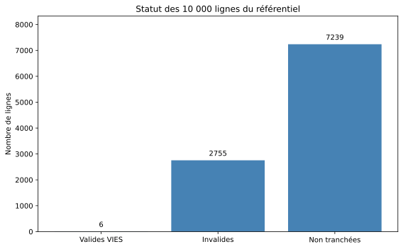
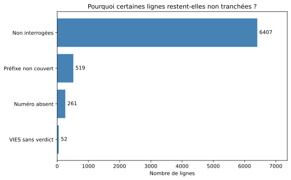
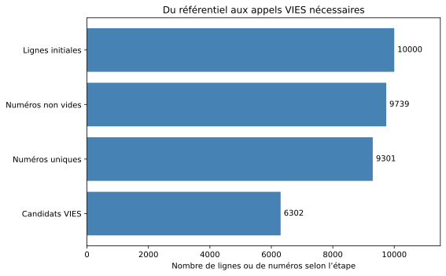

# Référentiel TVA : constats et priorités de régularisation

**À la directrice financière — Meridian Distribution**  
**Auteur : Amaury Ducoulombier, responsable de l’étude | 18 novembre 2026**

**La vérification du référentiel est partielle. Je recommande de poursuivre les contrôles en donnant la priorité aux dossiers des prochaines factures, selon un ordre à valider par la direction financière. Les résultats disponibles ne permettent pas de chiffrer l’exposition financière ni de décider du traitement fiscal des dossiers.**

## Ce que les contrôles établissent

### 1. État des 10 000 lignes

| Graphique | Lecture et portée |
|:---|:---|
|  | Sur **10 000 lignes**, répétitions incluses, **6** sont associées à un numéro confirmé valide dans VIES, **2 755** sont rejetées en l’état et **7 239** restent non tranchées. Les rejets comprennent 2 605 formats ou clés incorrects et 150 lignes associées à un verdict négatif VIES. **Ces comptes ne correspondent pas à des nombres de clients distincts.** |

### 2. Une absence de verdict a plusieurs causes

| Graphique | Lecture et suite proposée |
|:---|:---|
|  | L’essentiel reste **non interrogé : 6 407 lignes**. Les autres cas nécessitent une clarification du préfixe (519), un numéro à demander (261) ou une nouvelle tentative après erreur du service (52). **Non tranché ne signifie pas invalide.** Les 52 lignes sans verdict correspondent à 50 numéros distincts. |

### 3. Un volume de vérification réduit, avec une hypothèse à confirmer

| Graphique | Lecture et limite |
|:---|:---|
|  | Le nettoyage identifie **438 répétitions supplémentaires** et **6 302 candidats distincts**, dont 500 numéros avec un préfixe ajouté à titre de proposition. Cette hypothèse doit être confirmée ; une réponse sur le numéro proposé ne valide pas son rattachement au client. Sous cette hypothèse, **3 698 appels sont évités** par rapport à un appel par ligne. |

## Portée des résultats

Les **200 numéros tirés au hasard parmi les candidats** donnent **5 valides, 145 invalides et 50 sans verdict**. Les nombreux verdicts négatifs malgré une structure conforme justifient un examen ciblé des dossiers ; leur cause n’est pas établie. Avec 25 % de réponses non tranchées, ces proportions ne permettent pas une estimation précise de la validité globale et ne sont pas appliquées directement aux 10 000 lignes. Les comparaisons entre canaux, pays et années ne démontrent pas une origine unique des erreurs.

## Suites proposées et arbitrages attendus

| Actions proposées par le data analyst | Arbitrages et informations attendus de la direction financière |
|---|---|
| **Préparer une liste priorisée des dossiers à vérifier**, puis poursuivre la collecte et conserver chaque réponse datée. | Fournir les prochaines échéances de facturation et valider les priorités, les responsables opérationnels et le calendrier. Le lien entre lignes, clients actifs et factures reste à établir. |
| **Isoler les données à corriger**, les 500 reconstructions à confirmer et les numéros sans verdict à retenter, sans effacer l’historique. | Désigner les équipes chargées de contacter les clients et arrêter le circuit de décision pour les dossiers non résolus. Le script actuel n’automatise pas une nouvelle campagne de réexamen. |
| **Produire un suivi des dossiers corrigés, vérifiés et encore ouverts**, à chaque revue convenue. | Fixer la date de revue et les objectifs. Le délai de régularisation dépendra des moyens mobilisés et des réponses des clients. |
| **Estimer l’exposition financière si les données nécessaires sont disponibles.** | Fournir les montants, le statut des factures et les éléments fiscaux pertinents. Aucune estimation monétaire n’est présentée à ce stade. |

**Règle proposée à valider :** prévoir une vérification actualisée avant une nouvelle facturation ; conserver date, réponse et décision. Un verdict ne garantit pas une validité permanente. La direction financière définit la fréquence retenue, la procédure en cas d’indisponibilité de VIES et le traitement fiscal.

*Sources : rapport de réconciliation, campagne VIES de 200 numéros et journal de collecte ; vérifications des 17 et 18 novembre 2026. Une validité confirmée ne prouve pas, à elle seule, que le numéro appartient au client du référentiel.*
